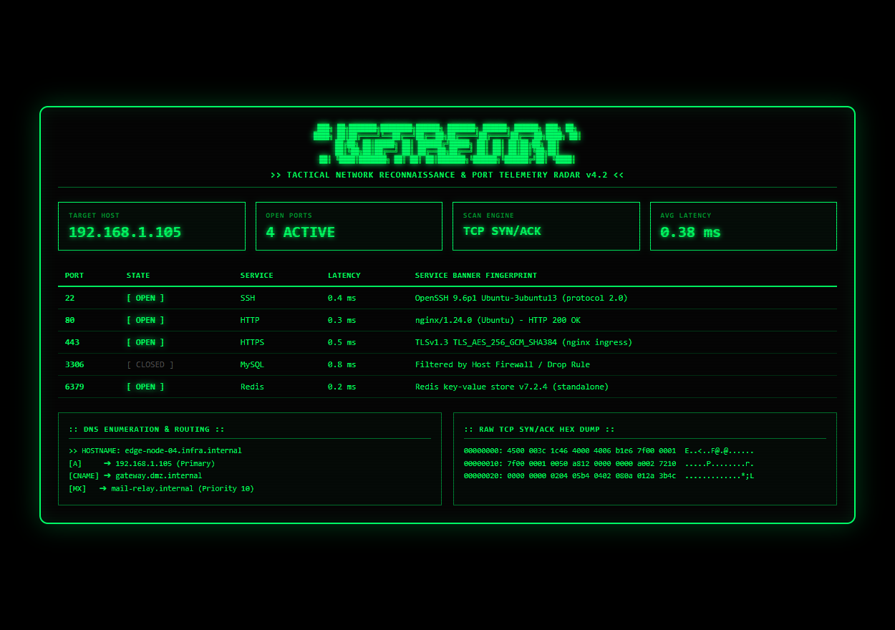

# NetRecon — Tactical Cyberpunk Terminal

Многопоточный инструмент сетевой разведки, инспекции портов и анализа баннеров сервисов, выполненный в визуальной стилистике **Phosphor Green Matrix / Cyberpunk CRT TUI**.

Глубокий черный фон `#050505`, светящийся зеленый моноширинный шрифт `#00FF66`, псевдографические ASCII-сетки и шестнадцатеричный HEX-дамп пакетов.



## Архитектура проекта

```text
net-recon-terminal/
├── recon/
│   ├── config.py              # Справочник системных портов (21..27017)
│   ├── scanner.py             # Многопоточный TCP Connect сканер с замером latency
│   ├── dns_recon.py           # Резолвинг A, CNAME, MX и TXT записей хоста
│   └── ui/
│       └── terminal_app.py    # Визуализатор киберпанк-терминала на Rich TUI
├── tests/                     # Unit-тесты сканера и DNS
├── run_recon.py               # Точка входа для запуска
└── requirements.txt
```

## Функционал

1. **⚡ Многопоточный TCP-сканер:** параллельный опрос пула критических портов с замером времени отклика (RTT latency в миллисекундах).
2. **🔍 Фингерпринтинг сервисов (Banner Grabbing):** перехват служебных баннеров версий ПО (SSH daemon, HTTP-сервер, СУБД).
3. **🌐 DNS-разведка:** определение канонического имени хоста, поиск алиасов и почтовых серверов.
4. **💾 Шестнадцатеричный сниффер:** демонстрационный RAW TCP SYN/ACK HEX-дамп заголовков сетевых пакетов.

## Быстрый старт

1. Установка:
   ```bash
   git clone https://github.com/username/net-recon-terminal.git
   cd net-recon-terminal
   pip install -r requirements.txt
   ```
2. Запуск сканирования локального или внешнего хоста:
   ```bash
   python run_recon.py 127.0.0.1
   ```
3. Запуск тестов:
   ```bash
   pytest
   ```

